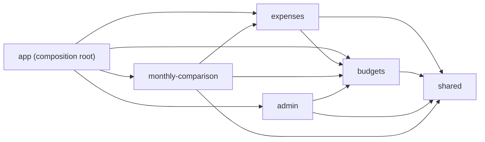

# Sienra Gastos — control de gastos y presupuestos

Aplicación web mobile-first para la **Clínica Veterinaria Sienra** (Uruguay). Resuelve un problema concreto: la clínica llevaba los gastos de memoria y se enteraba de un exceso (por ejemplo, un mes con más cirugías) recién al cierre del mes, cuando ya no había nada que ajustar. Esta aplicación muestra, en cualquier momento del mes, cuánto se gastó por categoría frente a su presupuesto mensual (en pesos uruguayos, UYU), y avisa antes del cierre: amarillo desde el 80 % del presupuesto y rojo cuando se supera.

Todo funciona en el navegador: no hay backend ni servicios externos (salvo la carga de tipografías desde Google Fonts). Los datos se guardan en `localStorage`.

## Tabla de contenidos

- [Funcionalidades](#funcionalidades)
- [Demo: datos de ejemplo](#demo-datos-de-ejemplo)
- [Requisitos](#requisitos)
- [Instalación y uso local](#instalación-y-uso-local)
- [Scripts disponibles](#scripts-disponibles)
- [Testing](#testing)
- [Arquitectura](#arquitectura)
- [Modelo de dominio](#modelo-de-dominio)
- [Persistencia](#persistencia)
- [Integración con backend (para Kodarvia)](#integración-con-backend-para-kodarvia)
- [Identidad visual](#identidad-visual)
- [Rendimiento](#rendimiento)
- [Despliegue en Netlify](#despliegue-en-netlify)
- [Calidad de código](#calidad-de-código)
- [Limitaciones conocidas](#limitaciones-conocidas)
- [Licencia y créditos](#licencia-y-créditos)

## Funcionalidades

- **Resumen mensual** con el total general del mes arriba y una tarjeta por categoría: presupuesto, gastado y barra de progreso. Amarillo desde el 80 %, rojo cuando se supera el 100 %, con alertas visibles.
- **Alta de gastos** con categoría, monto (mayor a cero) y fecha obligatorios; la descripción es opcional. El formulario no se envía si falta un dato requerido.
- **Edición y eliminación** de gastos; eliminar pide confirmación dentro de la aplicación. Los totales se recalculan al instante, sin recargar.
- **Historial** con filtros combinables por categoría y rango de fechas, y búsqueda por texto en la descripción.
- **Reinicio mensual automático**: los totales se calculan por mes calendario de cada gasto; el historial nunca se borra y los presupuestos no cambian con el mes.
- **Mes anterior** en modo solo lectura, para comparar con el mes en curso.
- **Panel de administración** protegido por clave, único lugar donde se editan los presupuestos. Incluye "Restablecer datos de ejemplo".
- **Persistencia** entre recargas y reaperturas de pestaña.
- **Mobile-first**: sin elementos recortados ni botones ocultos en teléfonos.

## Demo: datos de ejemplo

Cuando el almacenamiento está vacío (o corrupto), la aplicación genera datos de ejemplo **relativos a la fecha actual**, de modo que la demostración siempre funciona:

- **Mes en curso** (17 gastos, ubicados en días hasta hoy): *Medicamentos y farmacia* supera el presupuesto (aprox. 112 %, en rojo) e *Insumos clínicos* queda entre el 80 % y el 100 % (aprox. 87 %, en amarillo). La historia: este mes hubo más cirugías.
- **Mes anterior** (13 gastos): un mes tranquilo y dentro de presupuesto, para la vista de comparación.

**Clave de administración de la demo:** `sienra2026`.

Para cambiarla o quitar la pista, editar `src/features/admin/domain/auth.ts`:

- `ADMIN_PASSWORD`: la clave (constante en texto plano; solo apta para demo).
- `SHOW_DEMO_PASSWORD_HINT`: poner `false` para que la pantalla de acceso deje de mostrar "Clave de demostración: …".

La sesión desbloqueada se guarda en `sessionStorage` y termina al cerrar la pestaña.

## Requisitos

- Node.js 20 o superior (`engines` en `package.json`). El despliegue en Netlify usa Node 22 (`.nvmrc` y `netlify.toml`).
- npm (incluido con Node.js).

## Instalación y uso local

```bash
npm install
npm run dev        # servidor de desarrollo (Vite)
npm run build      # typecheck + build de producción en dist/
npm run preview    # sirve el build en http://localhost:4173
```

## Scripts disponibles

| Script | Qué hace |
| --- | --- |
| `npm run dev` | Servidor de desarrollo de Vite. |
| `npm run build` | Verifica tipos (`tsc --noEmit`) y genera el build de producción en `dist/`. |
| `npm run preview` | Sirve `dist/` en `http://localhost:4173` (puerto estricto). |
| `npm run typecheck` | Verifica tipos con TypeScript, sin emitir archivos. |
| `npm run lint` | Ejecuta ESLint sobre todo el proyecto (incluye la regla `no-console`). |
| `npm test` | Vitest en modo watch. Usar `npm test -- --run` para una sola ejecución. |
| `npm run test:e2e` | Pruebas E2E con Playwright (construye y levanta `preview` automáticamente). |
| `npm run check:bundle` | Falla si el JavaScript de producción supera 150 KB gzip. Requiere `npm run build` previo. |

## Testing

El proyecto se desarrolló con **TDD estricto** (RED → GREEN → REFACTOR), con forma de pirámide: muchas pruebas unitarias rápidas sobre el dominio y la aplicación, un grupo menor de pruebas de integración de la interfaz y un conjunto reducido de escenarios E2E de aceptación.

| Nivel | Herramienta | Dónde viven | Cobertura |
| --- | --- | --- | --- |
| Unitarias | Vitest | `src/**/*.test.ts` junto al código | Reglas de dominio (estado de presupuesto, validación, dinero, meses), casos de uso, repositorios y semilla. |
| Integración | Vitest + Testing Library (jsdom) | `src/app/*.integration.test.tsx` | Pantallas completas con almacenamiento en memoria y reloj fijo: resumen, gastos, mes anterior, administración. |
| E2E | Playwright | `e2e/` (`acceptance.spec.ts`, `layout.spec.ts`) | Criterios de aceptación, persistencia tras recargar y ausencia de desbordamiento horizontal en móvil. |

**Cantidades actuales:** Vitest, 21 archivos de prueba con 168 pruebas; Playwright, 20 escenarios ejecutados en 3 proyectos (60 pruebas).

```bash
npm test -- --run                          # unitarias + integración
npx playwright install chromium webkit     # una sola vez: descarga los navegadores
npm run test:e2e                           # E2E en los tres proyectos
```

Proyectos de Playwright (`playwright.config.ts`):

- `desktop-chromium`: Desktop Chrome.
- `mobile-android`: emulación de Pixel 7 (Chromium).
- `mobile-ios`: emulación de iPhone 14 sobre WebKit real.

Las pruebas E2E congelan el reloj en **martes 20 de octubre de 2026** (`NOW` en `e2e/fixtures.ts`), por lo que los datos de ejemplo y los totales son deterministas.

## Arquitectura

**DDD con cortes verticales (vertical slicing)**: cada capacidad del negocio es un *slice* en `src/features/<slice>/` con sus propias capas `domain`, `application`, `infrastructure` y `ui`. Lo transversal vive en un núcleo compartido (`src/shared`) y la composición se hace en `src/app`.

```
src/
├── app/                      # raíz de composición
│   ├── container.ts          # único lugar donde se eligen adaptadores concretos
│   ├── App.tsx, AppProviders.tsx, AppRoutes.tsx, AppShell.tsx
│   ├── DashboardPage.tsx
│   └── *.integration.test.tsx
├── features/
│   ├── budgets/              # categorías, estado del presupuesto, resumen mensual
│   │   ├── domain/           # category, budgetStatus, categorySummary, ports, validateBudget
│   │   ├── application/      # getMonthlyOverview, updateBudget
│   │   ├── infrastructure/   # localBudgetRepository
│   │   └── ui/               # CategoryCard, CategoryGrid, MonthlyTotalCard
│   ├── expenses/             # alta, edición, baja, historial, semilla
│   │   ├── domain/           # expense, validateExpense, searchText, ports
│   │   ├── application/      # addExpense, editExpense, deleteExpense, queryHistory
│   │   ├── infrastructure/   # localExpenseRepository, seed
│   │   └── ui/               # ExpenseForm, HistoryPage, ExpenseList, HistoryFilters, ...
│   ├── monthly-comparison/   # vista de solo lectura del mes anterior
│   │   ├── application/      # compareMonths
│   │   └── ui/               # PreviousMonthPage, ComparisonSection
│   └── admin/                # clave, sesión y edición de presupuestos
│       ├── domain/           # auth, ports
│       ├── application/      # adminAccess
│       ├── infrastructure/   # storageAdminSession
│       └── ui/               # AdminLogin, AdminPage, BudgetEditor
├── shared/                   # núcleo compartido
│   ├── domain/               # money, yearMonth, clock (puerto), storage (puerto), result, id
│   ├── infrastructure/       # localStorage/sessionStorage/memoria, SystemClock, FixedClock, uuid
│   └── ui/                   # Button, Card, Dialog, ProgressBar, formatters, icons
└── test-utils/               # renderApp (helpers de prueba)
```

**Regla de dependencias:** `domain` (TypeScript puro, sin React ni almacenamiento) ← `application` (casos de uso, reciben repositorios y reloj por parámetro) ← `infrastructure` y `ui` ← `app` (raíz de composición, el único que conoce los adaptadores concretos). El dominio nunca importa de capas externas.

**Puertos y adaptadores:**

- `KeyValueStorage` (`src/shared/domain/storage.ts`): puerto de almacenamiento clave/valor; adaptadores de `localStorage`, `sessionStorage` y en memoria.
- `Clock` (`src/shared/domain/clock.ts`): puerto del reloj; `SystemClock` en producción y `FixedClock` en pruebas.
- Puertos de repositorio por slice en `domain/ports.ts` (`ExpenseRepository`, `BudgetRepository`, `AdminSession`).



## Modelo de dominio

**Categorías y presupuestos mensuales por defecto** (`src/features/budgets/domain/category.ts`):

| Id | Categoría | Presupuesto (UYU) |
| --- | --- | --- |
| `insumos-clinicos` | Insumos clínicos | 90.000 |
| `medicamentos-farmacia` | Medicamentos y farmacia | 120.000 |
| `servicios` | Servicios (luz, agua, gas) | 35.000 |
| `personal` | Personal | 150.000 |

**Estado del presupuesto** (`budgetStatus.ts`, aritmética entera para que los límites sean exactos):

| Estado | Condición | Color |
| --- | --- | --- |
| `ok` | gastado < 80 % | verde |
| `warning` | 80 % ≤ gastado ≤ 100 % | amarillo |
| `exceeded` | gastado > 100 % | rojo |

**Validación de un gasto** (`validateExpense.ts`):

- Categoría: debe ser una de las cuatro existentes.
- Monto: entero positivo (mayor a cero).
- Fecha: obligatoria y real (formato `AAAA-MM-DD`; se rechazan fechas inexistentes como 31 de febrero).
- Descripción: opcional, hasta 140 caracteres.

**Reinicio mensual:** nunca se borra ni se reinicia nada. Los totales mensuales se derivan de los gastos cuya fecha cae en el mes calendario actual, según el `Clock` inyectado. El día 1 el resumen vuelve a cero, mientras los gastos anteriores permanecen en el historial y alimentan la vista "Mes anterior". Los presupuestos no dependen del mes.

## Persistencia

Todo se guarda en el navegador, con claves versionadas (`v1`):

| Almacenamiento | Clave | Contenido |
| --- | --- | --- |
| `localStorage` | `sienra.v1.expenses` | Arreglo JSON de gastos. |
| `localStorage` | `sienra.v1.budgets` | Objeto JSON con el presupuesto por categoría. |
| `sessionStorage` | `sienra.v1.admin-unlocked` | Marca de administración desbloqueada (dura mientras la pestaña esté abierta). |

- **Versionado:** el sufijo `v1` en la clave permite introducir un formato nuevo (`v2`) sin pisar datos existentes.
- **Datos corruptos:** si el JSON es inválido o no cumple el formato, los presupuestos vuelven a los valores por defecto y los gastos se tratan como inexistentes (se vuelve a sembrar). En listas parcialmente válidas se descartan solo los registros mal formados.

## Integración con backend (para Kodarvia)

La aplicación está preparada para cambiar `localStorage` por una API:

- **Puerto de almacenamiento:** `src/shared/domain/storage.ts` (`KeyValueStorage`); adaptadores en `src/shared/infrastructure/`.
- **Repositorios:** `LocalExpenseRepository` y `LocalBudgetRepository` implementan los puertos declarados en `domain/ports.ts` de cada slice. Para integrar un backend, implementar esos puertos contra la API y cambiarlos en `src/app/container.ts`, el único lugar donde se eligen los adaptadores concretos.
- **Sincronía:** hoy los repositorios son **síncronos**. Un backend real requiere que los puertos y los hooks de `src/app/AppProviders.tsx` pasen a ser asíncronos (carga, errores y estados de espera).
- **Autenticación:** la verificación de la clave está en `src/features/admin/domain/auth.ts` (`ADMIN_PASSWORD`, `checkAdminPassword`) y es solo para demo. Debe trasladarse al servidor (autenticación real, sesión o token y autorización de la edición de presupuestos), y se debe eliminar `SHOW_DEMO_PASSWORD_HINT`.

## Identidad visual

| Color | Hex | Uso |
| --- | --- | --- |
| Azul clínica | `#7FC7D9` | Color de marca y `theme-color` (variantes `#E8F5F9` de fondo y `#2F7F94`). |
| Blanco | `#FFFFFF` | Tarjetas y superficies. |
| Verde salud | `#6FAE7B` | Acción principal y estado correcto (variantes `#3E7A4B`, `#E9F4EB`). |
| Tinta | `#1B2A2E` | Texto principal (variante suave `#4A5B60`). |
| Ámbar | `#E0A526` | Estado de advertencia (variantes `#7A5800`, `#FFF6DD`). |
| Rojo | `#D64545` | Estado excedido (variantes `#A62B2B`, `#FDECEC`). |

- **Tipografía:** Nunito (700/800) para títulos e Inter (400/500/600) para el cuerpo, cargadas desde Google Fonts, con `system-ui` como respaldo.
- **Accesibilidad:** contraste AA; texto en color tinta sobre el botón verde de acción principal; objetivos táctiles de al menos 44 px; diseño mobile-first; sin imágenes de stock.

## Rendimiento

- **Presupuesto de tamaño:** el JavaScript de producción (carga inicial más chunks diferidos) no debe superar **150 KB gzip**. Hoy ronda los 66 KB.
- **Rutas con carga diferida:** "Mes anterior" y "Admin" se cargan bajo demanda (`React.lazy`) para mantener liviana la primera carga.
- **Verificación:** `npm run build && npm run check:bundle`; el script falla si se supera el límite.

## Despliegue en Netlify

La configuración está en `netlify.toml` y `.nvmrc` (Node 22); no se necesita CLI de Netlify.

1. En Netlify: **Add new site → Import an existing project** y conectar el repositorio de GitHub `fer1994ly/clinicaveterinaria`.
2. Rama de producción: `main`.
3. Los ajustes de build se leen automáticamente de `netlify.toml`: comando `npm run build`, directorio de publicación `dist`, `NODE_VERSION = "22"`.
4. Desplegar. Cada pull request genera un **Deploy Preview** (si está habilitado en el sitio).

Qué configura `netlify.toml`:

- **Redirección SPA** (`/*` → `/index.html`, estado 200): la aplicación usa `BrowserRouter`; sin esta regla, abrir o recargar rutas como `/gastos` o `/admin` daría 404.
- **Caché:** `/assets/*` (archivos con hash) con `public, max-age=31536000, immutable`; `/index.html` con `no-cache` para que cada despliegue nuevo se recoja de inmediato.
- **Cabeceras de seguridad** en `/*`: `X-Content-Type-Options: nosniff`, `Referrer-Policy: strict-origin-when-cross-origin`, `X-Frame-Options: DENY`, `Permissions-Policy` (cámara, micrófono y geolocalización deshabilitados) y una `Content-Security-Policy` que permite solo recursos propios, más estilos de `fonts.googleapis.com` y tipografías de `fonts.gstatic.com`. Si se agrega otro recurso externo, hay que ampliar la política.

**Alternativa manual:** ejecutar `npm run build` y arrastrar la carpeta `dist/` a la sección *Deploys* del sitio en Netlify. Un despliegue manual de `dist/` no incluye `netlify.toml`, por lo que la redirección SPA y las cabeceras no se aplicarían; para mantenerlas, el sitio debe estar conectado al repositorio.

## Calidad de código

- **Lint:** `npm run lint` (ESLint con TypeScript y reglas de React Hooks). La regla `no-console` está en `error` para todos los archivos (código, pruebas E2E, scripts y configuraciones): no se admite ningún `console.*`; los scripts de Node escriben con `process.stdout.write` y `process.stderr.write`.
- **Tipos:** `npm run typecheck`.
- **Commits:** [Conventional Commits](https://www.conventionalcommits.org/) (`feat:`, `fix:`, `test:`, `docs:`, `chore:`), un commit por unidad de trabajo con sus pruebas y documentación.

## Limitaciones conocidas

- Los datos viven en el navegador: no se comparten entre dispositivos ni usuarios, y se pierden si se borran los datos del sitio.
- La clave de administración es una constante en el código del cliente: sirve para la demostración, no ofrece seguridad real.
- Una sola moneda (UYU) y cuatro categorías fijas; solo los presupuestos son editables.
- Los presupuestos son únicos y no varían por mes.
- Los repositorios son síncronos (ver la sección de integración con backend).
- Las tipografías se cargan desde Google Fonts, por lo que requieren conexión en la primera visita.

## Licencia y créditos

Uso privado. Proyecto desarrollado para Clínica Veterinaria Sienra a través de Kodarvia.
